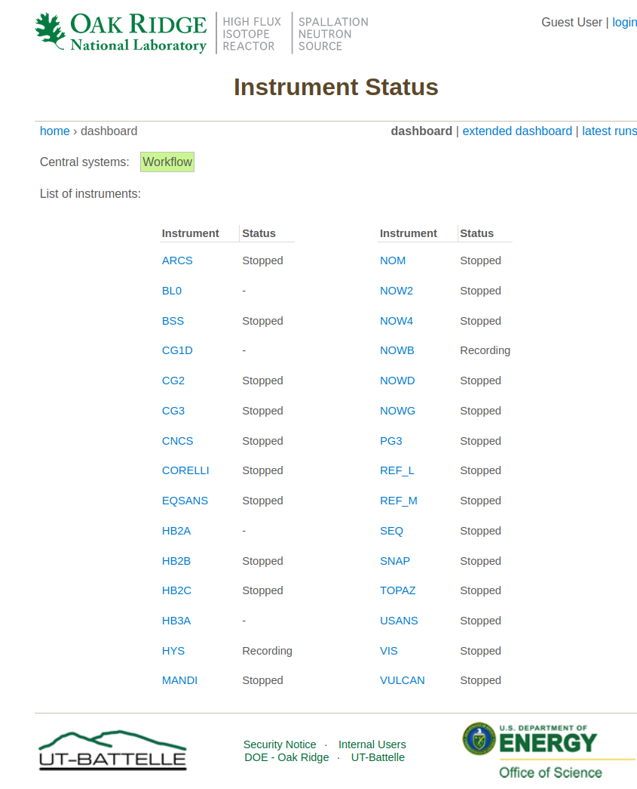
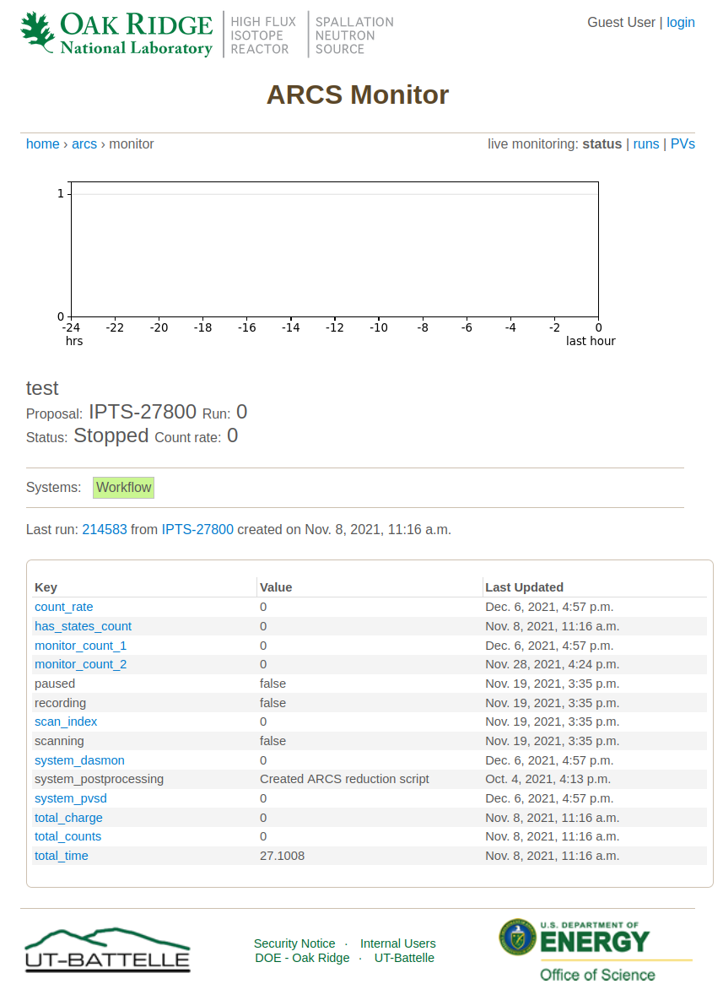
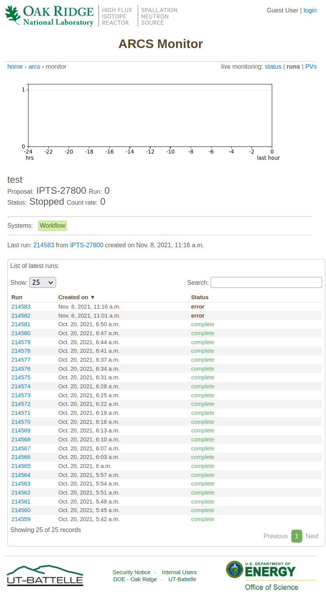
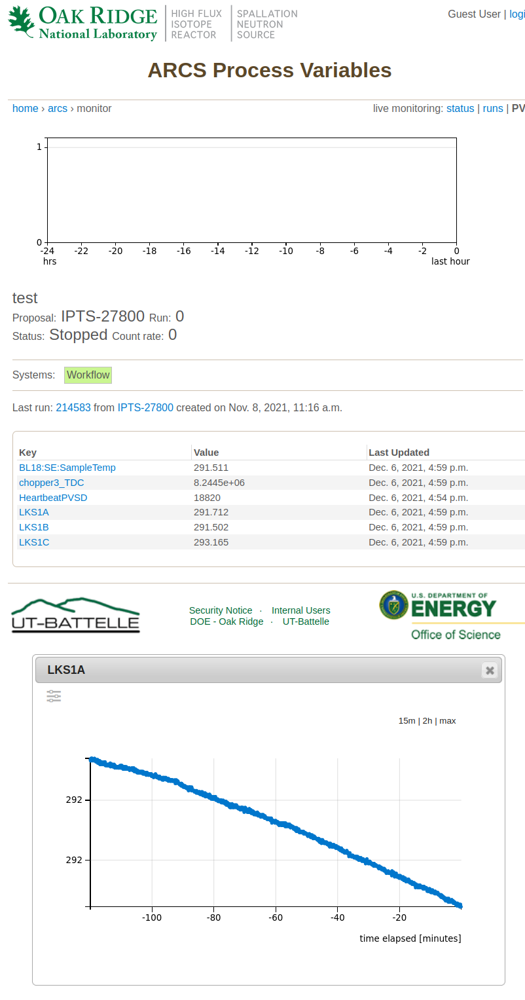
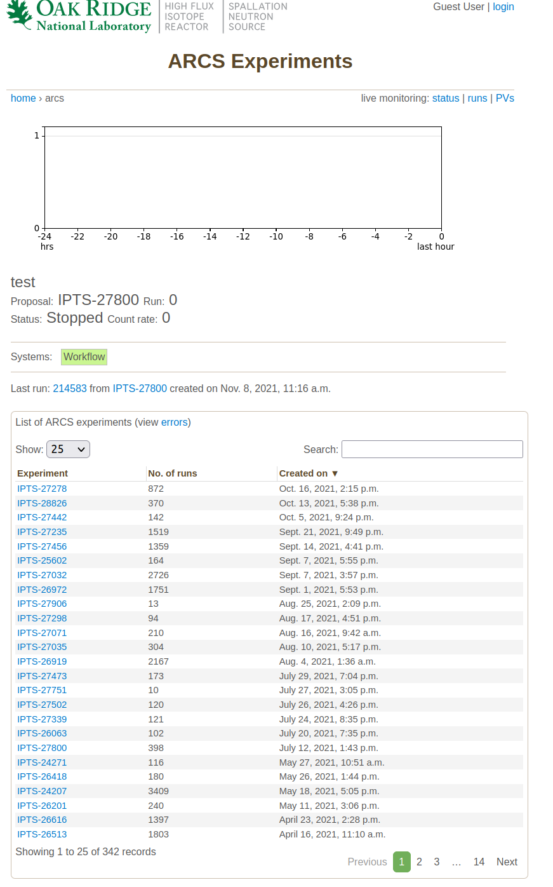
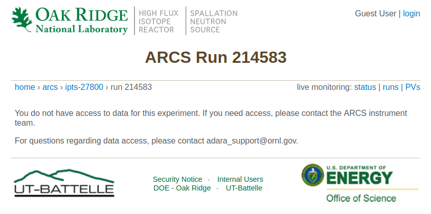

Guest User View
===============

.. toctree::
   :maxdepth: 2

Anyone can see a list of instruments and whether each one is running.

Everything else requires logging in with your `UCAMS/XCAMS <https://user.ornl.gov/Account/Login>`_
credentials. Clicking on an instrument takes you to the login page, and the pages below are what you'll
see once you're logged in.

When clicking on any instrument one can see the status of the instrument. The status page shows a
list of *monitored variables*. The sample logs to display can be configured in CSS (the frontend
interface for the instrument control), see instructions
`here <https://powder.ornl.gov/general_aspects/data_acquire/monitor.html>`_.

|

In the top right hand side, there are links to see the runs in the current
experiment, together with the processing status.

For example, runs that are actively collecting data will display a status of
*“Acquiring”*. Once acquisition finishes, the run may move to a *“Processing”*
status, and finally show *“Complete”* once processing is done.

In addition, there is a list of process variables (PVs). These are a list of sample
environment and instrument parameter logs.
If one clicks on a PV link, it will show the history of that PV in the last 15 minutes or 2 hours.
The ``y`` scale can be switched between linear and logarithmic.

Clicking on the instrument name in the breadcrumbs will display a list of `IPTS <https://ipts.ornl.gov>`_ experiments

Run details are only shown to members of the experiment or the instrument team. Anyone else who clicks on a
run will see that they don't have access to the data

